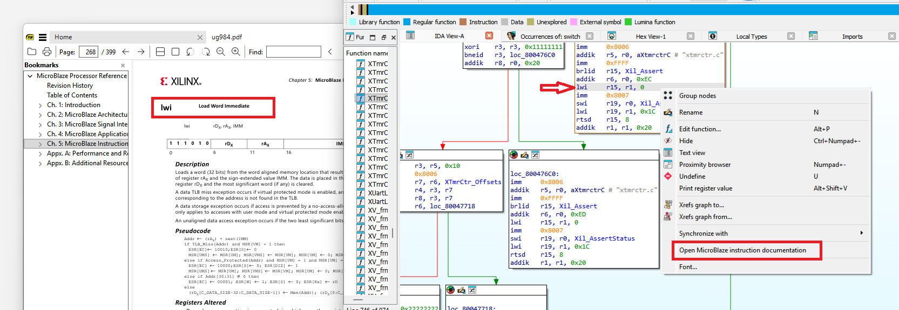
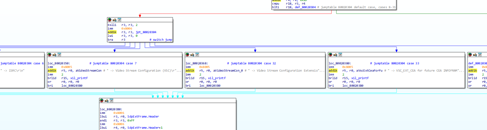
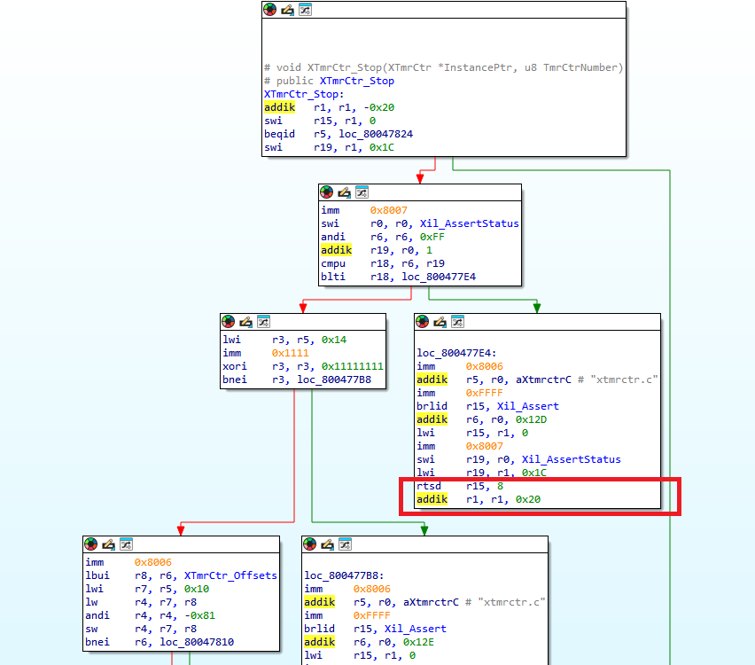

# MicroBlaze IDA Support Package

Version: 1.0.0.82.

Windows x64, IDA Pro 8.4 (`ida64.exe`).

## Quick start

1. Extract the ZIP into a writable directory. Keep its files together.
2. Set `IDA_HOME` to the directory containing `ida64.exe`, or edit the commented example in `CMD\mb_setenv.cmd`.
3. Run `CMD\load_mb.cmd "path\to\firmware.elf"`. Without a filename, it opens IDA so you can select a file.
4. MicroBlaze ELFs are recognized on subsequent File/Close and File/Open operations too. The default processor is `microblaze` (32-bit). For 64-bit MicroBlaze, set `MB_PROCESSOR=microblaze64` before launching. ELF class and flags do not reliably identify that mode.

The launcher uses this package's `ida-user` directory and does not modify your IDA installation. 

## Instruction documentation

Keep `mb_docs64.dll` installed even if you do not use instruction help: it also provides persistent ELF identification.

Right-click an instruction and choose **Open MicroBlaze instruction documentation**. The matching manual page opens in SumatraPDF, reusing its window. Download and install [SumatraPDF](https://www.sumatrapdfreader.org/download-free-pdf-viewer), then set `SUMATRA_PDF` to its executable before launching IDA.

The manual is not included. Help opens local download instructions when it is missing. Download [AMD UG984 version 2022.1](https://docs.amd.com/v/u/2022.1-English/ug984-vivado-microblaze-ref) and save it as `ida-user\plugins\docs\ug984-vivado-microblaze-ref.pdf`. Use that exact edition for correct page links. SDK-only mnemonics without manual entries produce a message in IDA's Output window.



## Analysis

The processor supports instruction operands, control flow, delay slots and guarded jump-table recognition. Switch recognition is enabled by default and can be controlled with the processor option `MB_SWITCHES=0` or `MB_SWITCHES=1`. Automatic switch recognition currently applies to 32-bit mode and requires a proven bound and valid table targets.

### Switch recognition

IDA displays the jump-table dispatch with case labels and edges to the case blocks.



### Control flow and delay slots

The highlighted return keeps `rtsd` and its following `addik` in the same block. The stack adjustment executes in the delay slot before the return takes effect.



## Package contents

```text
CMD/load_mb.cmd
CMD/mb_setenv.cmd
ida-user/procs/microblaze64.dll
ida-user/plugins/mb_docs64.dll
ida-user/plugins/mb-docs.csv
ida-user/plugins/docs/download-manual.html
readme.md
license.md
manifest.json
doc/images/Mr_Wolf.jpg
doc/images/case_switch.png
doc/images/flow_delay_slot.png
doc/images/documentation.png
```

Both DLLs are release builds with the same version. Windows Properties → Details shows their versions. `manifest.json` contains SHA-256 hashes for the payload files; a checksum of the ZIP is provided alongside it.

The package excludes PDFs, PDBs, SDKs, databases, firmware and development tools. By using it, you accept the [terms of use](license.md).

Author: Mr Wolf — [mr.wolf.is.me@gmail.com](mailto:mr.wolf.is.me+microblaze_ida@gmail.com)


